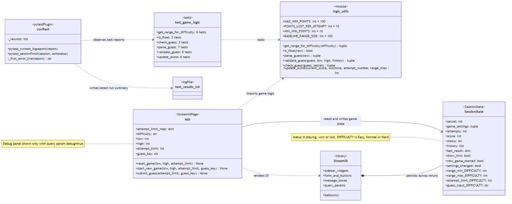

# 🎮 Game Glitch Investigator: The Impossible Guesser

## 🚨 The Situation

You asked an AI to build a simple "Number Guessing Game" using Streamlit.
It wrote the code, ran away, and now the game is unplayable. 

- You can't win.
- The hints lie to you.
- The secret number seems to have commitment issues.

## 🛠️ Setup

1. Install dependencies: `pip install -r requirements.txt`
2. Run the broken app: `python -m streamlit run app.py`

## 🕵️‍♂️ Your Mission

1. **Play the game.** Add `?debug=true` to the address to see the secret number. Try to win.
2. **Find the State Bug.** Why does the secret number change every time you click "Submit"? Ask ChatGPT: *"How do I keep a variable from resetting in Streamlit when I click a button?"*
3. **Fix the Logic.** The hints ("Higher/Lower") are wrong. Fix them.
4. **Refactor & Test.** - Move the logic into `logic_utils.py`.
   - Run `pytest` in your terminal.
   - Keep fixing until all tests pass!

## 📝 Document Your Experience

- [ ] Describe the game's purpose.

The game is trying to guess a number using a limited number of guesses. If done correctly, it is near 100% to always guess the correct number.
- [ ] Detail which bugs you found.

1. Delay when submitting a guess
2. Could not press enter to submit a guess
3. Disallowing repeat/out of bounds/decimal values
4. Game logic lives in logic_utils.py
5. Test results differed from expected return value
6. Whitespaces in guesses
7. Debug panel shown immediately
8. Hint was hiding win message
9. Old guesses were not cleared when inputting a new range
- [ ] Explain what fixes you applied.

I applied all that I deemed were a necessary or valuable enough fix. This includes all the fixes that were listed above.

I also made these changes so the game logic is easier to test and change later:

- **Guess validation moved to `logic_utils.py`.** The range check and the repeat-guess check now live in `validate_guess()`, next to `parse_guess()` and `check_guess()`, so they can be tested without running the app.
- **Scoring rules have names.** The numbers used for scoring are constants at the top of `logic_utils.py`, so you can change the scoring in one place:

  | Constant | Value | Meaning |
  |---|---|---|
  | `MAX_WIN_POINTS` | 100 | Points for a first-try win |
  | `POINTS_LOST_PER_ATTEMPT` | 10 | Points lost for each extra guess |
  | `MIN_WIN_POINTS` | 10 | Fewest points a win can earn |
  | `BASELINE_RANGE_SIZE` | 100 | Range size worth 1x points (1–100) |

- **More tests.** Every function in `logic_utils.py` now has tests (32 in total).
- **Test results file stays small.** `pytest/test_results.txt` now holds only the latest test run instead of every run. Earlier results are kept in git history.

## 🗺️ Architecture



`app.py` draws the page with Streamlit and keeps the game state in `st.session_state`. All game rules live in `logic_utils.py`, which `tests/test_game_logic.py` tests. `conftest.py` writes each test run's results to `pytest/test_results.txt`.

The diagram source is in [diagrams/architecture.mmd](diagrams/architecture.mmd). You can paste it into [mermaid.live](https://mermaid.live) to edit it.

## 📸 Demo Walkthrough

Describe your fixed game in numbered steps so a reader can follow along without watching a video:

1. **Start the game.** Run `python -m streamlit run app.py`. The game opens in your browser at `http://localhost:8501`.
2. **Pick a difficulty** in the sidebar. Each one sets a default range and number of attempts:

   | Difficulty | Range | Attempts |
   |---|---|---|
   | Easy | 1–20 | 10 |
   | Normal | 1–100 | 8 |
   | Hard | 1–200 | 5 |

   You can also type your own **Min**, **Max** (up to 1000) and **Attempts allowed** (1 to 20). Changing any setting starts a new game, clears the guess box and shows "New game started."
3. **Make a guess.** Type a whole number and press **Enter** or click **Submit Guess 🚀**. These guesses are rejected with a message and *don't* use up an attempt:
   - an empty guess, or one with only spaces
   - text, like `abc`
   - decimals, like `4.5`
   - a number outside the range
   - a number you've already guessed
4. **Follow the hints.** After each wrong guess the game says **📉 Go LOWER!** or **📈 Go HIGHER!**, and the "Attempts left" counter goes down by one. Every guess so far is listed in the **Your guesses** box. Untick **Show hint** to play without hints.
5. **Win.** Guess the secret number to get balloons and a message like "🎉 Correct! You won! The secret was 57. Final score: 90". You still see this message with hints turned off.
   - A first-try win scores 100 on 1–100. Each extra guess costs 10 points, down to a minimum of 10.
   - Wider ranges are worth more: a first-try win scores 65 on 1–20, 115 on 1–200 and 150 on 1–1000.
6. **Or lose.** If you run out of attempts, the game shows the secret number and you score 0. A win always scores more than a loss.
7. **Play again.** Click **New Game 🔁** for a new secret number. Your attempts and score reset and the guess box is cleared.
8. **(Optional) Peek at the secret.** Add `?debug=true` to the address, e.g. `http://localhost:8501/?debug=true`, to show the **Developer Debug Info** panel. It shows the secret number, attempts, score, difficulty and guess history.

**Screenshot** *(optional)*: <!-- Insert a screenshot of your fixed, winning game here -->

## 🧪 Test Results

```
$ python -m pytest tests/
============================= test session starts =============================
platform win32 -- Python 3.14.3, pytest-9.1.1, pluggy-1.6.0
collected 32 items

tests\test_game_logic.py ................................                [100%]

============================= 32 passed in 0.07s ==============================
```

| Function | Tests |
|---|---|
| `get_range_for_difficulty` | 6 |
| `is_float` | 2 |
| `parse_guess` | 7 |
| `validate_guess` | 8 |
| `check_guess` | 3 |
| `update_score` | 6 |

Each run's full results, one line per test, are written to [pytest/test_results.txt](pytest/test_results.txt).

## 🚀 Stretch Features

- [ ] [If you choose to complete Challenge 4, describe the Enhanced UI changes here — a screenshot is optional]
