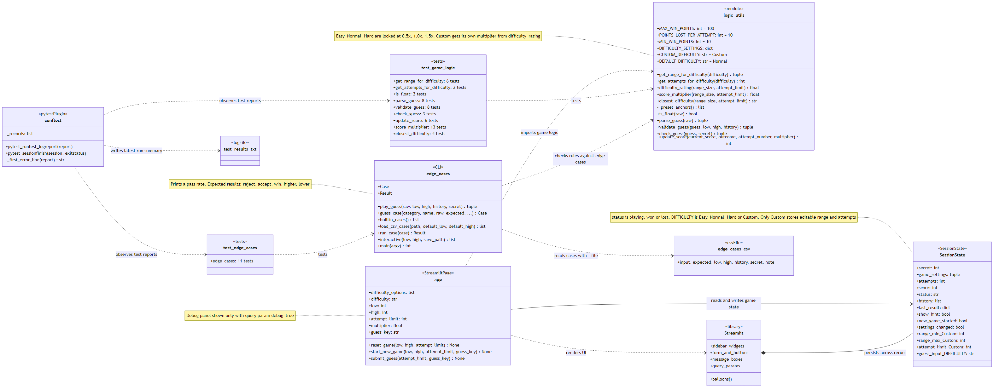

# 🎮 Game Glitch Investigator: The Impossible Guesser

## 📌 Summary

**Glitchy Guesser** is a number guessing game built with Streamlit. The game picks a secret number in a range, and you have a limited number of attempts to find it. After each wrong guess it tells you to go higher or lower. A player who halves the range each time can almost always find the number.

An AI wrote the first version of this game, said it was production-ready, and left it unplayable:

- You couldn't win.
- The hints lied to you.
- The secret number changed every time you clicked Submit.

This project finds and fixes those bugs, moves the game rules into code that can be tested, and adds tests to show the fixes work. It shows why AI-generated code has to be checked, not trusted: the code looked fine and ran without errors, but the game was broken.

My full write-up of the project is in [docs/reflection.md](docs/reflection.md).

### Bugs found and fixed

1. Delay when submitting a guess
2. Could not press Enter to submit a guess
3. Repeat, out-of-range and decimal guesses were allowed
4. Game logic was mixed into the UI code (now in `logic_utils.py`)
5. Guesses with underscores, like `1_0`, were accepted as numbers (found by the edge-case checker)
6. Spaces in guesses weren't handled
7. Debug panel (which shows the secret) was shown immediately
8. Turning off hints also hid the win message
9. Old guesses weren't cleared when the range changed

## 🗺️ Architecture Overview



The project is split into four parts:

- **[app.py](app.py)** draws the page with Streamlit and keeps the game state (secret, attempts, score, guess history) in `st.session_state`, so it survives each rerun of the script. It doesn't contain game rules: it calls `logic_utils.py` for them.
- **[logic_utils.py](logic_utils.py)** holds every game rule: reading a guess (`parse_guess`), checking it against the range and earlier guesses (`validate_guess`), giving the hint (`check_guess`), scoring (`update_score`, `score_multiplier`) and the difficulty settings. It has no Streamlit code, so it can be tested on its own.
- **[tests/](tests/)** holds the pytest tests. [tests/conftest.py](tests/conftest.py) writes each run's results to [test-results/test_results.txt](test-results/test_results.txt).
- **[edge_cases.py](edge_cases.py)** is a command-line tool that runs `logic_utils.py` against edge cases and prints a pass rate. You can add your own cases.

The diagram shows the first three parts; the edge-case checker was added after it was drawn. The diagram source is in [docs/diagrams/architecture.mmd](docs/diagrams/architecture.mmd). You can paste it into [mermaid.live](https://mermaid.live) to edit it.

## 🛠️ Setup Instructions

You need Python 3 (tested with Python 3.14).

1. **Get the code.** Clone the repository and open a terminal in its folder.
2. **(Optional) Create a virtual environment:**
   ```
   python -m venv .venv
   .venv\Scripts\activate        # Windows
   source .venv/bin/activate     # macOS / Linux
   ```
3. **Install dependencies:**
   ```
   pip install -r requirements.txt
   ```
4. **Run the game:**
   ```
   python -m streamlit run app.py
   ```
   It opens in your browser at `http://localhost:8501`.
5. **Run the tests:**
   ```
   python -m pytest
   ```
6. **Run the edge-case checker:**
   ```
   python edge_cases.py
   ```

## 📸 Demo Walkthrough

1. **Start the game.** Run `python -m streamlit run app.py`. The game opens in your browser at `http://localhost:8501`.
2. **Pick a difficulty** in the sidebar. Easy, Normal and Hard have a fixed range and number of attempts, which you can see but not change:

   | Difficulty | Range | Attempts | Score multiplier |
   |---|---|---|---|
   | Easy | 1–20 | 10 | 0.50x |
   | Normal | 1–100 | 8 | 1.00x |
   | Hard | 1–200 | 5 | 1.50x |
   | Custom | you choose | you choose | depends on your settings |

   **Custom** lets you type your own **Min**, **Max** (up to 1000) and **Attempts allowed** (1 to 20). It starts from Normal's settings. Custom gets its own multiplier, calculated from how hard your settings are compared with the three presets. It is never rounded to a preset's multiplier:
   - The game rates difficulty as *guesses a perfect player needs* (about log2 of the range size) divided by *attempts allowed*.
   - If your rating falls between two presets, your multiplier falls between theirs. For example, 1–150 with 6 attempts is between Normal and Hard and earns 1.27x.
   - Settings harder than Hard keep earning more, with no cap. For example, 1–1000 with 3 attempts earns 2.78x.
   - Settings easier than Easy earn less than 0.50x, so a 1–2 range with 20 attempts is worth almost nothing (0.06x).
   - The sidebar shows your multiplier and which preset your difficulty is most similar to, as a guide only.

   Changing difficulty or any Custom setting starts a new game, clears the guess box and shows "New game started."
3. **Make a guess.** Type a whole number and press **Enter** or click **Submit Guess 🚀**. These guesses are rejected with a message and *don't* use up an attempt:
   - an empty guess, or one with only spaces
   - text, like `abc`
   - decimals, like `4.5`
   - a number outside the range
   - a number you've already guessed
4. **Follow the hints.** After each wrong guess the game says **📉 Go LOWER!** or **📈 Go HIGHER!**, and the "Attempts left" counter goes down by one. Every guess so far is listed in the **Your guesses** box. Untick **Show hint** to play without hints.
5. **Win.** Guess the secret number to get balloons and a message like "🎉 Correct! You won! The secret was 57. Final score: 80". You still see this message with hints turned off.
   - A first-try win is worth 100 points. Each extra guess costs 10 points, down to a minimum of 10.
   - Those points are multiplied by the difficulty's multiplier: a first-try win scores 50 on Easy, 100 on Normal and 150 on Hard.
6. **Or lose.** If you run out of attempts, the game shows the secret number and you score 0. A win always scores more than a loss.
7. **Play again.** Click **New Game 🔁** for a new secret number. Your attempts and score reset and the guess box is cleared.
8. **(Optional) Peek at the secret.** Add `?debug=true` to the address, e.g. `http://localhost:8501/?debug=true`, to show the **Developer Debug Info** panel. It shows the secret number, attempts, score, difficulty, score multiplier and guess history.

## 💬 Sample Interactions

The game has no AI model in it, so these examples show what you type and what the game or the edge-case checker outputs in response. Every output below comes from a real run, with some repeated lines left out.

### 1. Playing a game on Normal (secret is 57)

| You type | Game responds | Attempts left |
|---|---|---|
| `abc` | ❌ That is not a number. | 8 (not used) |
| `4.5` | ❌ Decimals aren't allowed. Enter a whole number. | 8 (not used) |
| `150` | ❌ Your guess must be between 1 and 100. | 8 (not used) |
| `50` | ⚠️ 📈 Go HIGHER! | 7 |
| `75` | ⚠️ 📉 Go LOWER! | 6 |
| `50` | ❌ You already guessed 50. Try a different number. | 6 (not used) |
| `57` | ✅ 🎉 Correct! You won! The secret was 57. Final score: 80 | — |

The win came on the 3rd counted attempt: 100 − 2 × 10 = 80 points, times Normal's 1.00x multiplier.

### 2. Running the built-in edge cases

```
$ python edge_cases.py -f
==============================================================================
Glitchy Guesser edge cases
==============================================================================

------------------------------------------------------------------------------
Summary by category
  Guess input           19/19    100.0%
  Range and repeats     12/12    100.0%
  Hints                  7/7     100.0%
  Scoring                7/7     100.0%
  Difficulty settings   10/10    100.0%
------------------------------------------------------------------------------
Result: 55/55 edge cases passed (100.0%)
==============================================================================
```

`-f` lists only failures. Without it, every case is shown with what the game said, for example:

```
  PASS  digit separator  ['1_0' in 1..100]
        -> reject: That is not a number.
```

Before the fix, the same case failed and the run scored 54/55 (98.2%):

```
  FAIL  digit separator  ['1_0' in 1..100]
        expected 'reject', got 'accept'
        game said: accepted as 10
```

### 3. Testing your own cases interactively

```
$ python edge_cases.py -i
guess (range 1..100, no secret)> :secret 30
guess (range 1..100, secret 30)> 29
  expected [accept]> higher
  PASS  '29' in 1..100, secret 30
        -> higher: 📈 Go HIGHER!
  running total: 1/1 (100.0%)
guess (range 1..100, secret 30)> 1_000
  expected [accept]> reject
  PASS  '1_000' in 1..100, secret 30
        -> reject: That is not a number.
  running total: 2/2 (100.0%)
guess (range 1..100, secret 30)> :range -10 10
guess (range -10..10, secret 30)> -0
  expected [accept]> accept
  PASS  '-0' in -10..10, secret 30
        -> accept: 📈 Go HIGHER!
  running total: 3/3 (100.0%)
guess (range -10..10, secret 30)> q

Result: 3/3 edge cases passed (100.0%)
```

### Using the edge-case checker

```
python edge_cases.py                              # built-in edge cases
python edge_cases.py -f                           # list only the failures
python edge_cases.py --file tests/edge_cases.csv  # your own cases
python edge_cases.py --interactive                # type cases one at a time
python edge_cases.py -i --save my_cases.csv       # ...and keep them for later
```

Each guess case states what the game should do with the input:

| Expected | Meaning |
|---|---|
| `reject` | The game refuses the guess and no attempt is used |
| `accept` | The game takes the guess |
| `win` | The guess matches the secret |
| `higher` | The hint says **Go HIGHER!** |
| `lower` | The hint says **Go LOWER!** |

`win`, `higher` and `lower` need a secret number. To add your own cases, copy the format of [tests/edge_cases.csv](tests/edge_cases.csv). In interactive mode, type `:help` to see how to set the range, secret and earlier guesses. The script exits with status 1 if any case fails. Use `--fail-under 90` to allow a lower pass rate.

## 🧭 Design Decisions

- **Game rules live in `logic_utils.py`, not `app.py`.** Streamlit code is hard to test because it needs a running page. Keeping the rules in plain functions means pytest and the edge-case checker can test them directly. *Trade-off:* the session-state code in `app.py` (starting a game, counting attempts, ending the game) still isn't covered by automated tests, so I tested it by hand.
- **Guesses are handled in button callbacks.** Streamlit reruns the whole script on every click. Scoring the guess in the Submit button's callback, before the page redraws, fixed the one-guess delay. *Trade-off:* messages written inside a callback are discarded, so they're stored in `st.session_state` and shown on the next draw, which makes the flow harder to follow.
- **Invalid guesses don't use an attempt.** Typing `abc` or repeating a guess is a mistake, not a real guess, so it shouldn't cost the player. *Trade-off:* the game is more forgiving than one that punishes careless input.
- **Locked presets plus a Custom mode.** Fixed presets keep scores comparable between players. Custom gives freedom, and its multiplier comes from a difficulty rating (log2 of the range size ÷ attempts) so easy settings can't be used to farm points. *Trade-off:* the formula is harder to explain than a fixed table, and Custom multipliers have no upper limit.
- **Named scoring constants.** `MAX_WIN_POINTS` (100), `POINTS_LOST_PER_ATTEMPT` (10) and `MIN_WIN_POINTS` (10) are at the top of `logic_utils.py`, so scoring can be changed in one place. Any win scores at least 1 point, so a win always beats a loss.
- **The debug panel needs `?debug=true`.** This keeps the secret off screen in normal play. *Trade-off:* it hides the secret but doesn't protect it, since anyone can add the parameter.
- **The test results file holds only the latest run.** This keeps `test-results/test_results.txt` small. Earlier runs are kept in git history.
- **The edge-case checker is a separate command-line tool.** pytest is good for developers, but the checker prints readable PASS/FAIL lines and a pass rate, and lets anyone add cases in a CSV file or by typing them, without writing Python. *Trade-off:* some of its built-in cases repeat checks that pytest already does.
- **Underscores are rejected with a simple check.** `parse_guess` refuses any input containing `_` before calling `int()`. *Trade-off:* `int()` still accepts other unusual digits, such as full-width `５`, which the game reads as 5. That seemed harmless, so I left it.

## 🧪 Testing Summary

**What worked**

- **pytest: 63 of 63 tests pass.** Every function in `logic_utils.py` has tests, and so does the edge-case checker:

  | Tested | Tests |
  |---|---|
  | `get_range_for_difficulty` | 6 |
  | `is_float` | 2 |
  | `parse_guess` | 8 |
  | `validate_guess` | 8 |
  | `check_guess` | 3 |
  | `update_score` | 6 |
  | `get_attempts_for_difficulty` (and Custom defaults) | 2 |
  | `score_multiplier` | 13 |
  | `closest_difficulty` | 4 |
  | `edge_cases.py` | 11 |

- **Edge-case checker: 55 of 55 built-in cases pass (100%),** and the 12 example cases in [tests/edge_cases.csv](tests/edge_cases.csv) all pass.
- Testing the rules apart from the UI made bugs quick to reproduce. Each fix has a test, so a later change can't quietly bring the bug back.

**What didn't work**

- **The checker found a bug the tests missed.** On its first run it scored 54/55 (98.2%): the game accepted `1_0` as 10, because Python's `int()` allows underscores between digits. None of the original 51 tests tried that input. It's now fixed and has a regression test.
- **The Streamlit UI isn't tested automatically.** The one-guess delay, Enter to submit, clearing the guess box and the debug panel were all checked by hand in the browser, so a UI regression could still get through.

Each pytest run's full results, one line per test, are written to [test-results/test_results.txt](test-results/test_results.txt).

```
$ python -m pytest
============================= 63 passed in 0.17s ==============================
```

## 💭 Reflection

Working with AI went best when I treated it like a fast teammate whose work I still had to check. I first played the game myself and fixed the bugs I could see, then asked the AI to look for logic errors I'd missed. Small, specific prompts that named exactly what to change worked better than asking for many things at once, because the AI sometimes changed more than I asked for. Once, it quietly undid an earlier fix. After every edit I read the difference to make sure only the intended code had changed, then checked the result in the app and with tests. The edge-case checker showed why this matters: the code looked correct and ran without errors, but it still accepted `1_0` as 10 until a test tried that input. My full reflection is in [docs/reflection.md](docs/reflection.md), and the system's limitations are in [model_card.md](model_card.md).
